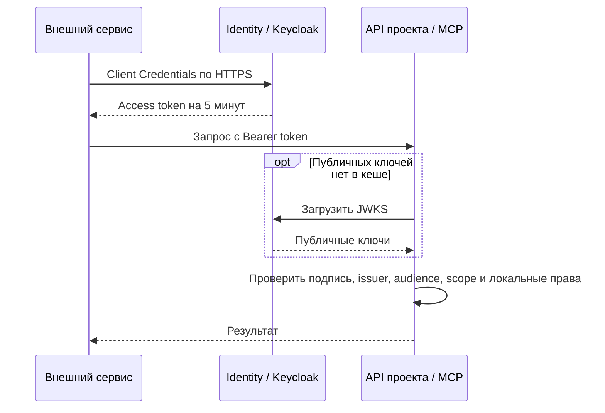

# Общий Identity-сервис — архитектурное предложение

Дата: 21.11.2026. Редакция: монорепо, самостоятельный Identity-сервис в `identity/`, без развёртывания.
План работ: [Identity_Service_Implementation_Plan.md](Identity_Service_Implementation_Plan.md).

## 1. Цель и граница проекта

Создать собственный инфраструктурный сервис OAuth/OIDC для нескольких проектов:
сначала выдача токенов автоматическим интеграциям, затем общий вход людей.
Первый потребитель — подготовленный Documentation MCP Symfony-приложения.
Размещение контролирует владелец инфраструктуры, включая выбор региона.

Identity владеет учётными записями, аутентификацией, ключами подписи и выдачей
токенов. Приложения владеют бизнес-данными, объектными правами и окончательной
авторизацией. Ни приложение, ни CI другого проекта не подключаются к БД Identity.

Сценарий первого этапа — автоматическая интеграция:

Сервис поставляется на основе Keycloak; продуктовый fork, собственная
криптография, собственный token endpoint и дополнительный API gateway в MVP
не требуются. Java-код и отдельный Symfony backend не входят в начальную поставку.

## 2. Сравнение подходов

| Подход | Польза | Цена сопровождения | Решение |
|---|---|---|---|
| Self-hosted Keycloak | Готовые OAuth/OIDC, service accounts и административная панель | Обновления, JVM-контейнер, PostgreSQL, эксплуатация | Рекомендованная основа |
| Self-hosted ZITADEL | Модель организаций и проектов подходит для B2B | Другие операционные процедуры и отдельная проверка token profile | Альтернатива, если обязательны B2B/organization-функции |
| Собственная реализация на Symfony/Go | Полный контроль над поведением продукта | Ответственность за протоколы, account recovery, MFA, ключи и обновления безопасности | Только при подтверждённой задаче разработки IAM-продукта |

Размещение в монорепо выбрано по запросу пользователя. Keycloak остаётся
проектной основой. Первый критерий принятия — реальная совместимость с MCP
в одноразовом стенде; при неуспехе пересмотреть решение в ADR до production.

## 3. Монорепо и независимое развёртывание

- Repository остаётся текущим: `pavelsur07/fin-dir-site`.
- Каталог сервиса: `/home/deploy/projects/vashfindir-site/identity/`.
- Самостоятельный компонент `identity/` находится рядом с `site/`, `conwix/`
  и `infra/`. В `site/src/` не переносится реализация OAuth-сервера.
- Текущего writable workspace достаточно. Новый sibling checkout, private repo
  и отдельные cross-repository credentials для MVP не требуются.
- Root `Makefile` предоставляет команды `identity-*` и делегирует их
  `identity/Makefile`; определения операций не дублируются. На выделенной VM
  тот же компонентный Makefile исполняется из пакета Identity.
- Архитектура и план остаются каноническими в текущем `docs/plan/`; инструкции
  эксплуатации и onboarding размещаются в `identity/docs/` при реализации.

Размещение исходников совместимо с отдельной production VM в выбранном регионе.
Общий вход сохраняет собственные ресурсы, БД, секреты и график обновления.

- Release artifacts: `/opt/identity/releases/<git-sha>`;
  активная версия — `/opt/identity/current`.
- CI собирает пакет из `identity/` и release manifest. Пакет не содержит
  `site/`, `conwix/`, чужих конфигураций или secrets; root git checkout на VM
  не нужен. Имя image/service и Git SHA фиксируются в manifest.
- Secrets/runtime settings: `/opt/identity/runtime/production/`, вне git/release tree.
- Backups: `/opt/identity/runtime/production/backups/` плюс зашифрованная внешняя копия.
- Compose projects: `identity-dev`, `identity-smoke`, `identity-staging`,
  `identity-production`; раздельные БД, сети, volumes, credentials и signing keys.

Пользователь выбрал текущий сервер сайта (176.124.218.113) и добавил DNS
auth.vashfindir.ru/auth-admin.vashfindir.ru. Общий хост — согласованное решение;
лимиты памяти KC640MB/PG192MB/ingress64MB и отсутствие HA зафиксированы в ADR0002. В этом случае используются labels Identity для существующего Traefik,
а не второй proxy на портах 80/443. Деплои не используют общий изменяемый checkout;
Identity доставляется в собственный release-каталог. Изменение общего Traefik
не прячется в релиз Identity. На выделенной VM ingress принадлежит Identity.

### CI, доступы и границы релиза

- Root `.github/workflows/identity-ci.yml` проверяет сервис; root
  `.github/workflows/deploy-identity.yml` выпускает только Identity.
- Изменения `identity/**` запускают IAM tests и реальный MCP consumer probe.
  Изменения verifier/DTO/его зависимостей в `site/` запускают contract probe
  также при неизменном `identity/`. Root Makefile, правила архитектуры и
  workflow/dependency definitions входят в impact matrix.
- Required check `identity-gate` запускается на каждом PR. Определение изменённых
  файлов выполняется внутри workflow; ненужные jobs могут пропускаться, но
  обязательный итоговый check не остаётся Pending из-за workflow-level paths.
- В MVP deploy выполняется явно по immutable SHA из защищённой основной ветки.
  Он требует полные Identity/recovery/consumer checks для выпускаемого SHA;
  зелёный PR gate с пропущенными jobs не является доказательством готовности релиза.
- GitHub environment/credentials Identity отделены от сайта; production secrets
  доступны только release job, не PR-проверкам. Разрешения workflow минимальны.
- CODEOWNERS и branch protection защищают `identity/` и управляющие workflows;
  это review policy, а не разделение чтения исходников. Доступ к git-репозиторию
  означает доступ к исходникам всех его компонентов. Для разных trust domains
  в будущем нужен отдельный репозиторий.
- Прямая зависимость только по OAuth/OIDC/HTTPS. Приложения не используют общий
  issuer secret или таблицы IAM; другой проект может жить в другом репозитории.
- Разные Git SHA/версии сайта и Identity допустимы: совместимость определяется
  проверенным контрактом, а не обязательным одновременным deployment.

На этапе bootstrap зафиксировать границу в root `AGENTS.md`, архитектурном ADR
и точечном дополнении `docs/architecture/PATTERNS.md`. `identity/AGENTS.md`
описывает vendor IAM/configuration, собственный Makefile и security/release rules.
Symfony остаётся security boundary своих APIs и владельцем бизнес-правил;
принятые правила Public Website/Admin продолжают действовать в своей области.
Техническая схема vendor Console Keycloak не переносится на React/Twig сайта.

Каталог сервиса и его runtime dependencies должны быть самодостаточны. Это
позволяет позднее вынести `identity/` с его историей, документацией и CI в
отдельный repository без изменения OAuth-контракта потребителей.

## 4. Предлагаемый стек

| Компонент | Выбор и политика |
|---|---|
| IAM | Официальный OCI image Keycloak **26.8.2** как проверенная база; собственный optimized runtime image с PostgreSQL/health/metrics settings, fixed base/runtime digests; до старта проверить security fixes |
| База данных | **PostgreSQL 17**, актуальный поддерживаемый patch с exact image digest; отдельные БД и пользователь Identity |
| Запуск | Linux VM, Docker Engine и Compose v2, production `start --optimized` |
| HTTPS / ingress | Traefik 3.x, минимум **3.6.1** при совместном использовании текущего Docker-хоста; exact patched version/digest фиксируется в новом проекте |
| Конфигурация | JSON manifests, versioned nonsecret templates, идемпотентный provisioning через Keycloak Admin REST API |
| Операционные инструменты | Root Makefile как интерфейс `identity-*`, делегирование `identity/Makefile`; Python **3.13** только в tooling image, HTTPX/PyJWT[crypto]/pytest/jsonschema, зависимости и tooling image фиксируются lock/digest |
| CI/CD | GitHub Actions: PR checks, isolated smoke, release по immutable SHA; защищённое production environment |
| Администрирование | Готовая консоль Keycloak, MFA и сетевое ограничение доступа |
| Наблюдаемость | Встроенные health/metrics, структурированные события и подключение к имеющемуся сбору логов/оповещений |

`latest` и floating image tags не используются в deploy. Точные digests/patches
заполняются проверкой registry в первой задаче, а не выдумываются в плане.
При наличии нового security patch базовую версию меняют с повторением contract smoke.
PostgreSQL 17 входит в поддерживаемые Keycloak версии; Java runtime уже есть
в официальном контейнере, отдельный JDK на VM не устанавливается.

MVP не требует Redis, Kubernetes, внешнего Infinispan, отдельного React UI или
платформы управления секретами, развёрнутой специально ради этого сервиса.
Используется существующая защищённая доставка secrets; расширения — по задаче.

## 5. Контракт и изоляция

### Имена и окружения

Предложения для DNS, которые нужно закрепить до выпуска токенов:

- production: `auth.vashfindir.ru`;
- staging: `auth-staging.vashfindir.ru`, отдельный экземпляр/БД;
- административный hostname: `auth-admin.vashfindir.ru`, доступ через VPN/allowlist.

Другой долгосрочный домен владельца допустим до первого выпуска. Изменение
issuer после подключения потребителей является миграцией, а не косметической правкой.
Production issuer при этих именах: `https://auth.vashfindir.ru/realms/projects`.
`master` используется только для администрирования.

Один realm `projects` подходит приложениям с общими пользователями и одной
политикой доверия. Независимые пользовательские базы/администраторы получают
отдельные realms; это не замена физическому разделению prod и staging.

### Приложения и клиенты

Каждая интеграция и окружение получают собственный client, credentials, scope
и audience. В MVP один M2M client обслуживает один ресурс. Примеры:

| Контракт | Client | Audience | Scope |
|---|---|---|---|
| Документация production | `docs-mcp-reader-prod` | `https://vashfindir.ru/mcp/docs` | `docs:read` |
| Документация isolated/staging proof | `docs-mcp-reader-staging` | `https://vashfindir.ru/mcp/docs` — текущий контракт consumer | `docs:read` |
| Второй ресурс в isolated tests | `isolation-proof-worker` | `urn:identity:contract:second-api` | `proof:read` |

У текущего MCP resource/Host зафиксированы в DocMcpHttpSettings/guards. Поэтому
первый isolated/staging proof использует тот же canonical resource URI, но
**другой точный issuer** и отдельный внутренний маршрут стенда с тестовым Host;
он не обращается к production-сайту. Это не публичный staging MCP URL.
Отдельный внешний staging MCP с собственной audience потребует самостоятельного
изменения конфигурационного контракта consumer, Host guards и metadata в его PR.

Второй ресурс — синтетический контракт теста, не изменение проекта Finance.
Доступ к нему токеном документации должен отклоняться и наоборот. Будущие
приложения получают собственные client roles; глобальная роль `admin` не
становится административным доступом ко всем продуктам.

### Token profile первого потребителя

Существующий `site/src/Documentation/Adapter/DocMcpOAuthVerifier.php` требует:

- RS256 и access-token header `typ=at+jwt`;
- точный `iss`, ожидаемый audience URI;
- непустой строковый `client_id`, строковый `scope` с `docs:read`;
- целочисленные `iat`, `exp`, при наличии `nbf`; `exp > iat`, TTL не более 300с;
- clock skew до 30с; при наличии `azp` он совпадает с `client_id`.

Настроить соответствующий client header type, service-account claim mappings
и Audience mapper. Не ослаблять verifier до принятия произвольных issuer,
algorithms, token types или отсутствующего client_id ради первого запуска.
Успех доказывает выпущенный Keycloak token, а не только JSON-конфигурация.

**Граница совместимости MCP:** в Keycloak 26.8.2 native Resource Indicators
(RFC 8707) и CIMD имеют experimental статус. В MVP эти features выключены:
используются заранее зарегистрированные M2M clients и scope/Audience mapper,
который всегда выдаёт только закреплённый audience. Клиент всё равно передаёт
`resource` целевого MCP. Документировать, что без feature Keycloak этот параметр
не обрабатывает и не обещает `invalid_target` для чужого resource. Изменение
параметра не расширяет закреплённый audience или разрешения.

Это ограниченный проверяемый профиль интеграции, не заявление о полной
совместимости со всеми MCP clients/revisions. CIMD, открытая dynamic registration,
offline refresh, token exchange и универсальное подключение desktop/chat
клиентов не входят в MVP. Их подключают отдельными проверенными профилями.

### Люди и окончательные права

Будущий вход людей: OIDC Authorization Code + PKCE S256, точные redirect URI,
`state`/`nonce`, идентификация по `(iss, sub)`. Email не является стабильным ID.
После входа Symfony создаёт собственную session cookie; браузер не хранит
bearer/refresh token в localStorage. Текущий Admin не мигрирует в рамках MVP.

API проверяет токен локально по разрешённому issuer и кешированным JWKS, затем
свои права на объекты/организации. M2M actor — `(iss, client_id)`.
Documentation сохраняет проверку своего локального grant на каждом запросе.
Отключение client у issuer само по себе не обещает мгновенного отказа уже
выпущенного offline-валидируемого JWT: общий срок отзыва — до TTL, либо отдельная
политика introspection/локального запрета для чувствительных операций.

## 6. Надёжность, конфигурация и эксплуатация

- Private keys, client secrets, bootstrap password и пользовательские exports
  не входят в git, image layers, output provisioning, CI artifacts или логи.
- Публикуются только HTTPS frontend/OIDC endpoints. `/admin` и Admin REST закрыты
  на публичном hostname; административный hostname ограничен сетью на reverse proxy.
  Администратор должен реально входить из разрешённой сети после применения правил.
- PostgreSQL и management port 9000 не публикуются наружу; внешние health/metrics
  закрыты. Фиксированный hostname, корректное доверие только своему proxy.
- MFA для администраторов, отдельный offline break-glass credential, bootstrap
  superadmin после настройки удаляется; автоматизация получает ограниченные права.
- Provisioning меняет только объявленные resources через Admin REST; имеет plan/apply,
  не удаляет realm, users или неизвестные clients, не ротирует secrets при повторе.
  Импорт realm при старте пригоден для первичного seed, но не для обновления
  существующего realm: повторный import его пропускает.
- Backup PostgreSQL вместе с необходимыми encryption/keystore материалами;
  checksum/TOC и восстановление на isolated стенде обязательны. Realm export
  не является полной резервной копией состояния сервера.
- Предлагаемые начальные цели: ежедневный backup, 14 дневных и 8 недельных
  зашифрованных копий, RPO до 24ч, RTO до 4ч; alert при неуспешном backup или
  нарушении возраста последней копии. Retention и цели подтверждаются владельцем
  и измеренным restore rehearsal;
  логическое восстановление возвращает также старые grants/keys/secrets — после
  инцидента проверять их и выполнять необходимую ротацию.
- Один Keycloak и один PostgreSQL в MVP означают допускаемый простой при
  обновлении/аварии VM. Это не HA. Отказ сервиса мешает новым входам и получению
  токенов; допустимое поведение API с уже валидным JWT/JWKS проверяется отдельно.
- До миграции множества пользовательских входов определить SLO и, если требуется,
  выделить этап HA: минимум две IAM-реплики и отказоустойчивую БД, с тестом отказа.
- Перед обновлением изучить migration guide и подтвердить возможность rollback.
  После несовместимой schema migration старый image нельзя считать безопасным
  rollback: нужен план восстановления БД с учётом RPO и потерянных новых изменений.

## 7. Повторное использование и границы MVP

Вместо собственного обязательного SDK поставляются:

1. Версионированный manifest нового проекта и M2M client с JSON schema.
2. Root `make identity-project-plan` / `make identity-project-apply` с идемпотентным поведением.
3. Инструкция для resource server и внешнего клиента на стандартных библиотеках.
4. Contract tests token profile и изоляции двух API.
5. Runbooks backup/restore, keys/client rotation, onboarding/offboarding и release.

Модель manifest v1 — только registered M2M/single-audience. Клиентам не передаётся
Management API credential. Другие проекты подключаются отдельными PR в своих
репозиториях, а не изменением их БД или общим copy-paste security-кодом.
Пример подключения доказывает как успешное чтение, так и невозможность доступа
токеном другого приложения, с истёкшим token и с отозванным local grant.

## 8. Условия начала и выпуска

Реализация выполняется в текущем workspace, в `identity/`, на feature branch.
Для production нужны:
подтверждённые hostname/VM/регион, защищённый доступ оператора, канал передачи
secrets, сетевой доступ admin и подтверждённые RPO/RTO. Эти параметры не требуются
для первого disposable compatibility стенда с временным TLS и credentials.

Изменения deploy workflows, общего Traefik, DNS/TLS, production credentials, CI environments,
production-БД и rollout требуют конкретного production scope. Данный документ
ничего из этого не создаёт и не означает разрешение на изменение соседних систем.
Перед релизом обязательны CI, независимое security review полного результата,
restore rehearsal и внешняя проверка MCP. Два документа пользователя
`ai-consultant-service-spec.md` / `website-ai-chat-spec.md` не являются частью задачи.

## 9. Первичные источники

Проверены 21.11.2026; выборы выше являются проектными рекомендациями.

- [Keycloak downloads: 26.8.2](https://www.keycloak.org/downloads).
- [Supported configurations: PostgreSQL и runtime](https://www.keycloak.org/server/supported-configurations).
- [Production configuration](https://www.keycloak.org/server/configuration-production).
- [Hostname](https://www.keycloak.org/server/hostname), [reverse proxy](https://www.keycloak.org/server/reverseproxy).
- [Server administration: realms, service accounts, audience](https://www.keycloak.org/docs/latest/server_admin/).
- [Release notes: настройка access-token header type](https://www.keycloak.org/docs/latest/release_notes/).
- [MCP integration, experimental features и Audience mapper](https://www.keycloak.org/securing-apps/mcp-authz-server).
- [Import/export limitations](https://www.keycloak.org/server/importExport).
- [OAuth Security BCP / RFC 9700](https://www.rfc-editor.org/rfc/rfc9700.html).
- [ZITADEL self-hosting](https://zitadel.com/docs/self-hosting/deploy/overview).
- [GitHub Actions: paths, jobs и workflows](https://docs.github.com/en/actions/reference/workflows-and-actions/workflow-syntax).

Локальные основания: `AGENTS.md`, `docs/architecture/PATTERNS.md`,
`infra/traefik/README.md`, `site/src/Documentation/Adapter/DocMcpOAuthVerifier.php`,
`site/src/Documentation/DTO/DocMcpHttpSettings.php`,
`docs/plan/Stage_Documentation_MCP_HTTP_Implementation.md`.
